# IlTa — тренажёр английской грамматики

Офлайн-приложение для Android (Kotlin + Jetpack Compose, Material 3) для отработки
английских **артиклей** и **предлогов**.

> **GitHub:** [github.com/Temnitsa/IlTa](https://github.com/Temnitsa/IlTa) ·
> **Готовый APK:** [IlTa 2.8.0](https://github.com/Temnitsa/IlTa/releases/latest) — 7,6 МБ, Android 8.0+,
> release-подпись, package `com.iltatrainer.app`, versionCode 10.
> SHA-256: `83d9b13504dfe6b6bdb31088ee1d9ade36aa633f9366d80a474eeea6bc13b2e3`.
> Установка: скачайте APK из Releases или `adb install -r IlTa-v2.8.0-release.apk`.

## Возможности

- **Три раздела** на входном экране: **Articles** (9 тем), **Prepositions** (6 тем), **Tenses** (12 тем).
- **2020 упражнений**: 9 тем статей по 70, 6 тем предлогов по 50–60, 12 тем времён по 90.
  В тренировке темы — 30 вопросов; у времён это **10 choice + 5 match + 15 сборка**.
  Сборка показывает русское предложение; английские слова собираются тапами; клавиатуры нет.
- **Быстрая тренировка с выбором тем**: во всплывающей шторке отмечаете галочками одну
  или несколько тем (можно микс) — тренировка собирается только из них; по умолчанию
  выбраны все темы, приоритет — слабым и новым вопросам.
- **Тренировка темы**: 30 вопросов из пула — разные проходы показывают разные примеры;
  настройка «Длина сессии» влияет только на быструю тренировку, разбор ошибок и тренировку раздела.
- **Быстрая тренировка**: секции в шторке свёрнуты, раскрываются тапом; можно выбрать
  темы и типы упражнений (выбор / соответствие / сборка).
- **Прогресс темы со штрафом**: на теме из 30 вопросов каждый верный ответ даёт ≈3,3%,
  ошибка отнимает два шага (≈6,7%). Процент **всегда растёт** за верный ответ (включая
  повторные) и поднимается при перепрохождении темы. На входном экране — «Вы изучили X%
  грамматики» (среднее по темам) с разбивкой по разделам; в статистике — тот же прогресс,
  серия дней и разбор ошибок.
- **Разбор ошибок с закрытием**: ошибка попадает в «Работу над ошибками» и закрывается,
  когда вы верно ответили на **исходный вопрос + 3 похожих вопроса этой темы**. Отдельная
  сессия «Работа над ошибками» автоматически собирает на каждую ошибку исходный + 3 похожих
  (4 вопроса); в статистике виден прогресс закрытия («Исходный: ✓ · Похожих: X/3»).
  **Избранное удалено** — ручные закладки дублировали автоматический разбор ошибок.
- **Понятные объяснения**: правила максимально компактны — формулы, короткие буллеты,
  маркеры и ошибки отдельными строками; в тексте есть **жирный** и *курсив*.
  В фидбеке ответа — структурированная сноска «Верно/Неверно → Почему → Перевод».
- **Двуязычный интерфейс RU/EN**, **тёмная/светлая тема**, динамические цвета Material You.
- **Офлайн-первый**: контент и прогресс хранятся на устройстве; интернет нужен только
  для проверки обновлений.
- **Экспорт/импорт прогресса** в JSON с максимальной совместимостью между версиями.
- **Обновления по воздуху**: при запуске и вручную приложение проверяет GitHub Releases;
  если доступна новая версия — у шестерёнки «Настройки» появляется красная точка,
  а в настройках — версия, заметки и кнопка «Скачать и установить». APK проверяется по
  пакету, `versionCode` и подписи, установка — через системный установщик.
  Подробности: [docs/github-release-setup.md](docs/github-release-setup.md).

## Скриншоты

| Темы / прогресс | Выбор тем для тренировки | Полная тренировка темы (1/30) |
|---|---|---|
| 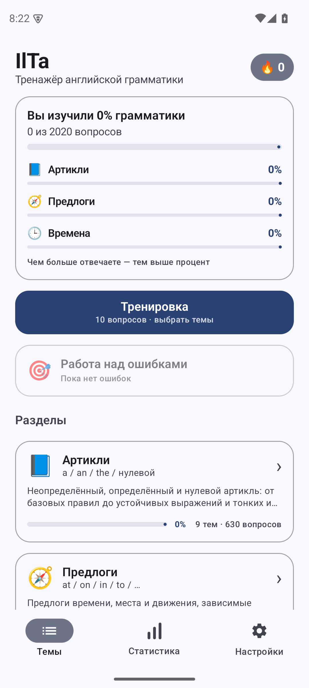 | 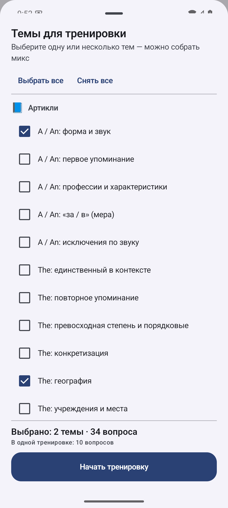 | 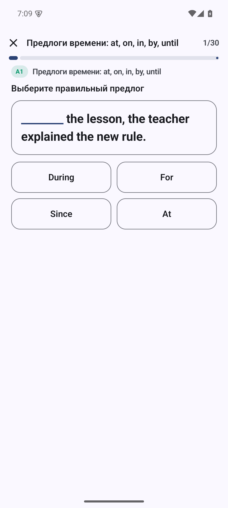 |

| Раздел «Артикли» | Тема: теория и прогресс | Разбор ответа |
|---|---|---|
| 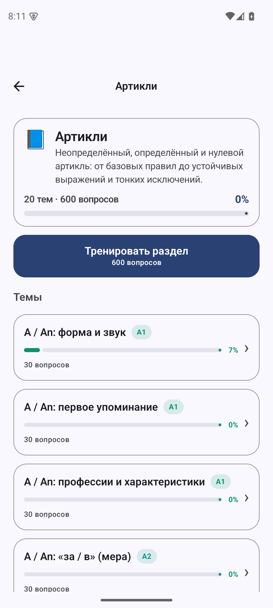 | 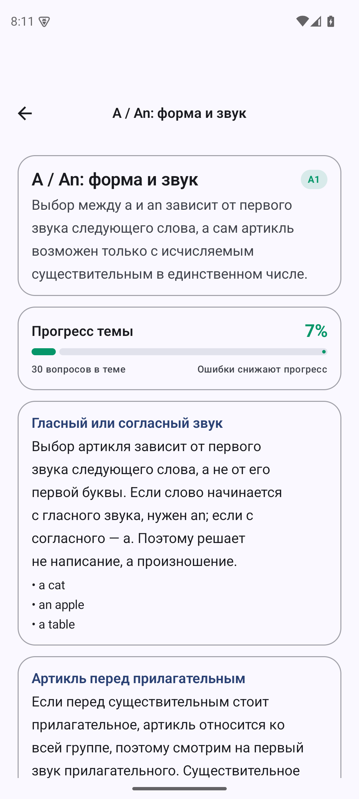 | 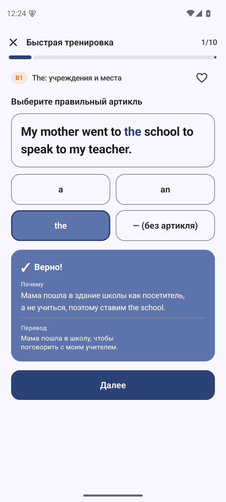 |

| Раздел «Предлоги» | Ошибки в работе | Сессия разбора ошибок |
|---|---|---|
| 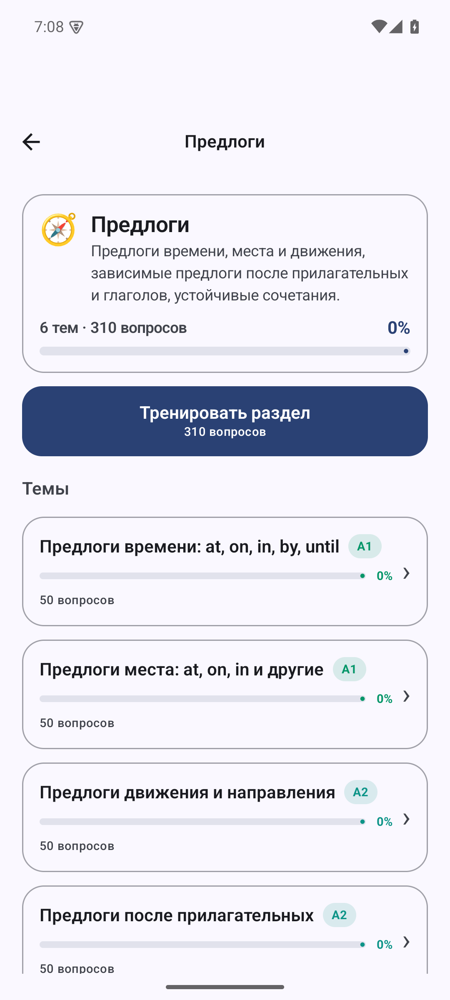 | 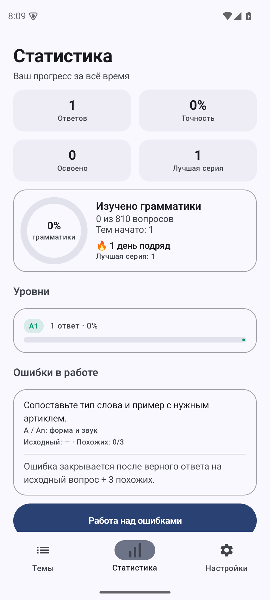 | 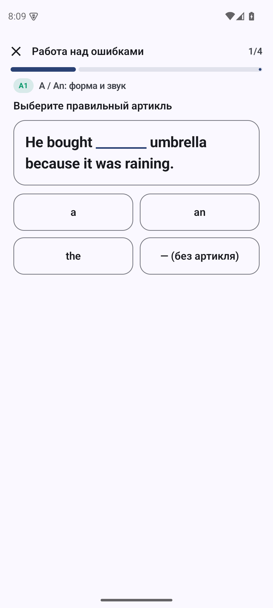 |

| Результат тренировки | Статистика | Настройки |
|---|---|---|
| 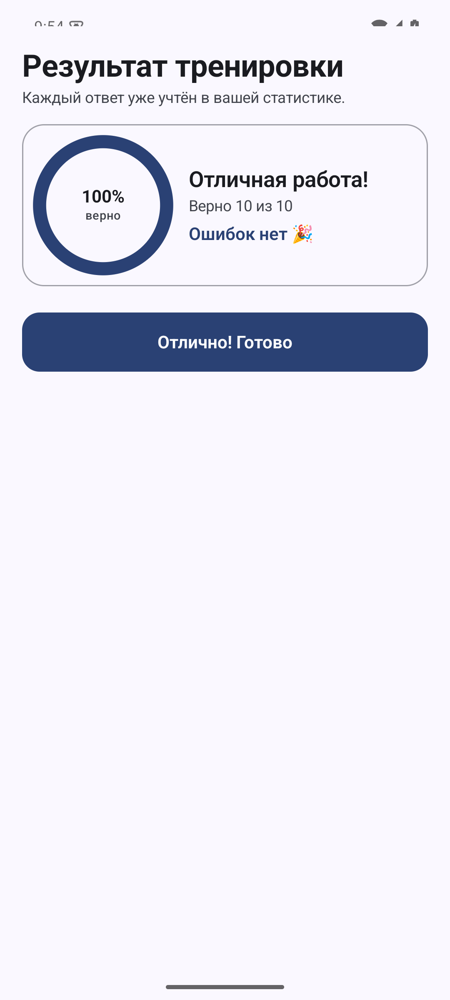 | 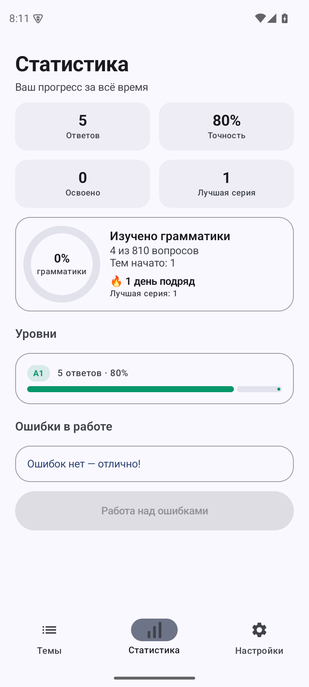 | 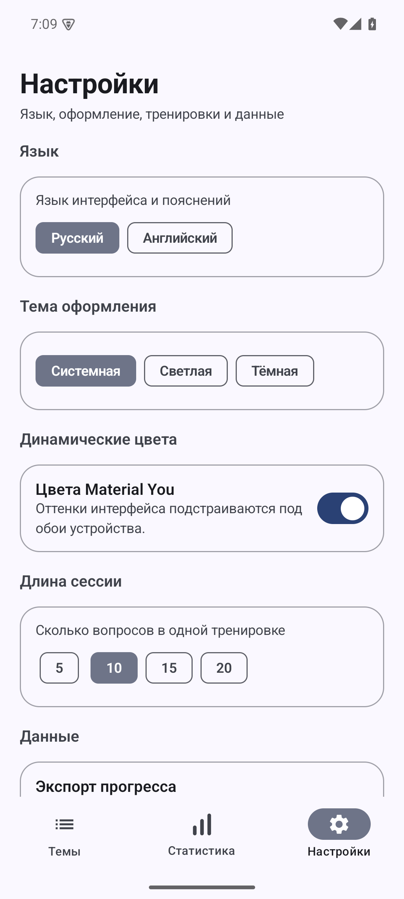 |

| Проверка обновлений | Обновление доступно | Установка |
|---|---|---|
| 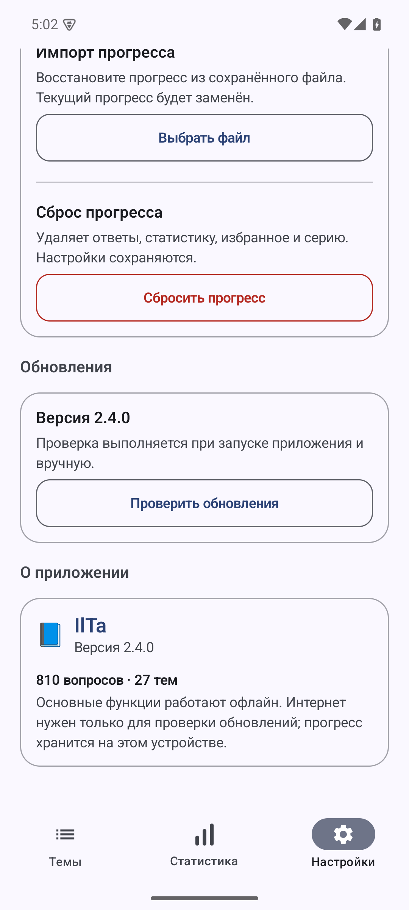 | 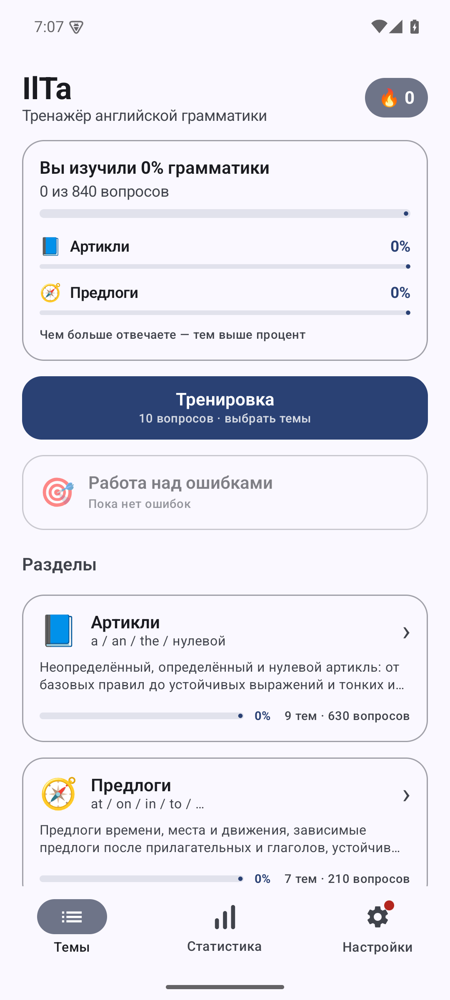 | 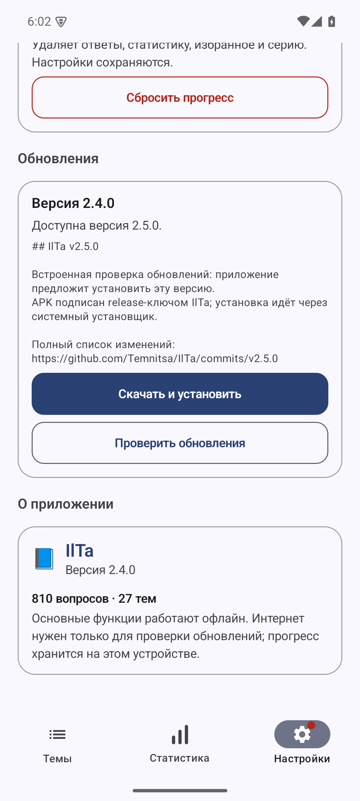 |

| Времена: 12 тем | Быстрая тренировка: секции | Типы заданий |
|---|---|---|
| 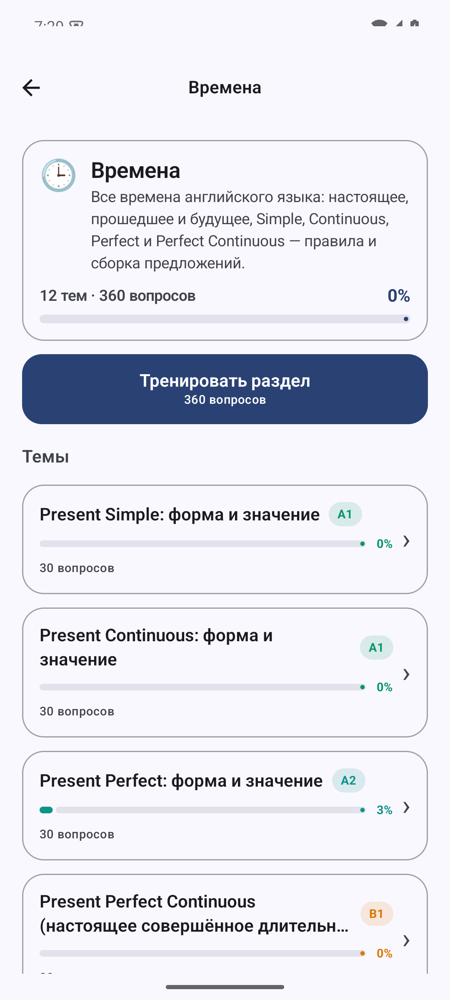 | 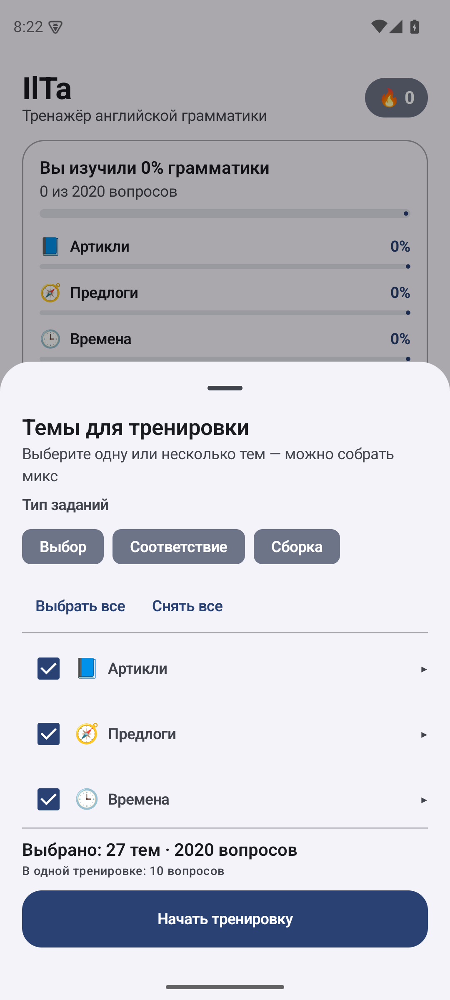 | 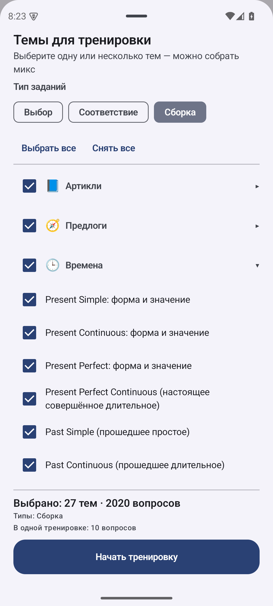 |

| Сборка: русское предложение | Компактная теория |
|---|---|
| 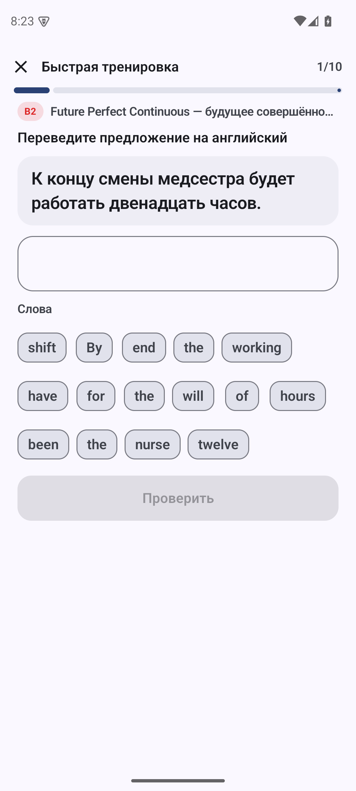 | 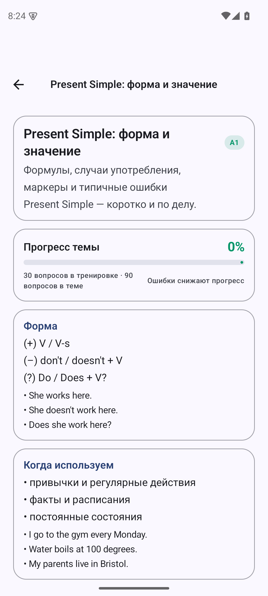 |

## Требования

- JDK 17+ (проверено на OpenJDK 21);
- Android SDK: platform `android-35`, build-tools `35.0.0`;
- Gradle 8.11.1 (wrapper в проекте).

## Сборка

### Android Studio
Откройте корень проекта, укажите путь к SDK в `local.properties` (`sdk.dir=...`) и соберите
`app` → `Build > Build Bundle(s) / APK(s) > Build APK(s)`.

### Командная строка
```bash
# если Java/SDK уже настроены и local.properties указывает на SDK:
./gradlew :app:assembleDebug
# APK: app/build/outputs/apk/debug/app-debug.apk

# в этом воркспейсе SDK и Gradle лежат локально в .tooling/:
scripts/gradle.sh :app:assembleDebug

# unit-тесты (логика ответов, сессии, прогресс, ошибки, импорт конфига, контент)
scripts/gradle.sh :app:testDebugUnitTest
```

Локальное окружение сборки (`.tooling/`, `.gradle/`, `.android/`) не входит в git — оно нужно
только для сборки в этом воркспейсе; каталоги можно удалить, если SDK/Gradle установлены системно.

## Структура проекта

```
app/src/main/java/com/iltatrainer/app/
├── MainActivity.kt
├── core/          Language / ThemeMode
├── data/          модели контента, sections.json, ProgressStore, ProgressConfigCodec, AppContainer
├── domain/        проверка ответов, сборка сессии, статистика (чистый Kotlin)
├── ui/            навигация, локализация, тема, общие компоненты
│   ├── components/  карточки, чипы уровней, прогресс-кольцо, подсветка ответа
│   └── screens/     Topics (разделы), Section (темы раздела), RuleDetail,
│                    Practice, Result, Stats, Settings
└── res/           иконка, темы, строки

app/src/main/assets/data/
├── sections.json                 разделы: Articles, Prepositions
└── content/*.json                правила и вопросы (8 паков)
```

## Контент

Контент лежит в `app/src/main/assets/data/` (разделы + паки правил и вопросов).
Схема описана в [docs/content-schema.md](docs/content-schema.md), каталог тем —
в [docs/rule-catalog.md](docs/rule-catalog.md). Приложение при старте читает все
JSON-файлы папки `content`, поэтому контент можно расширять без изменения кода.

| Раздел | Тем | Вопросов | Пул | Тренировка |
|---|---|---|---|---|
| Articles (артикли) | 9 | 630 | 70 на тему | 30 (5 match + 25 choice) |
| Prepositions (предлоги) | 6 | 310 | 50–60 на тему | 30 (5 match + 25 choice) |
| Tenses (времена) | 12 | 1080 | 90 на тему | 30 (10 choice + 5 match + 15 build) |
| **Всего** | **27** | **2020** | | |

Тексты правил: `body` объясняет правило и **не дублирует примеры**; примеры — только
в списке `examples` под правилом (3–5 на секцию). Это проверяется валидатором.

Проверка контента:

```bash
python3 scripts/validate_content.py app/src/main/assets/data/content
```

Валидатор проверяет JSON-схему, секции и ссылки на правила, единственный пропуск `___`,
варианты и правильный ответ, ru/en объяснения, переводы, дубликаты, квоты 30/25/5 на тему
и отсутствие примеров внутри текста правила.

## Прогресс и экспорт

Прогресс хранится в `SharedPreferences` как JSON (`ProgressState`). Экспорт создаёт файл
`ilta-progress-YYYY-MM-DD.json` со схемой 3:

```json
{
  "app": "IlTa",
  "schema": 3,
  "appVersion": "2.3.0",
  "exportedAt": "2026-11-01T10:00:00Z",
  "content": { "sections": 3, "rules": 27, "questions": 2020, "contentSchema": 3 },
  "state": {
    "version": 1, "totalAnswered": 120, "totalCorrect": 96,
    "mistakes": { "question-id": { "ruleId": "...", "originalCorrect": false, "similarCorrect": 2 } },
    "closedMistakes": 3, "...": "..."
  }
}
```

**Совместимость версий** (`ProgressConfigCodec`):
- импортируется любой файл: новый (schema 3), старые schema 1/2 (включая бэкапы ArticleWise),
  «сырой» `ProgressState` без обёртки и файл из будущей версии приложения;
- неизвестные поля игнорируются, новые поля получают значения по умолчанию; поле `favorites`
  из старых конфигов принимается, хотя в интерфейсе избранного больше нет;
- повреждённые/переименованные поля спасаются по одному, недостающее восстанавливается
  из дневной истории;
- статистика и открытые ошибки по незнакомым id сохраняются и подхватятся, если те же id
  вернутся в будущем контенте;
- импорт не отклоняется из-за версии схемы. Всё происходит локально через SAF.

## Тесты

```bash
scripts/gradle.sh :app:testDebugUnitTest
```

- `AnswerCheckerTest` — проверка вариантов ответа (артикли и предлоги);
- `SessionBuilderTest` — режимы сессий, выбор подмножества тем, разбор ошибок «исходный + 3 похожих»;
- `StatsCalculatorTest` — точность, серии, аддитивный штрафной прогресс темы;
- `ProgressSerializationTest` / `ProgressConfigCodecTest` — сериализация и совместимость конфига;
- `ContentValidationTest` — 3 раздела, 27 тем, 2020 вопросов, пулы 70/50–60/90, тренировка 30, build-вопросы, компактные правила.

## Проверка

- 49 unit-тестов и валидатор контента — зелёные.
- QA-ревью контента: [статьи v2.2](docs/qa-review-v3-articles.md),
  [предлоги v2.2](docs/qa-review-v3-prepositions.md),
  [новые вопросы статей v2.3](docs/qa-review-v4-articles.md),
  [новые вопросы предлогов v2.3](docs/qa-review-v4-prepositions.md),
  [структура статей 2.5, часть A](docs/qa-review-v5-articles-a.md),
  [структура статей 2.5, часть B](docs/qa-review-v5-articles-b.md),
  [структура предлогов 2.6, часть A](docs/qa-review-v6-prepositions-a.md),
  [структура предлогов 2.6, часть B](docs/qa-review-v6-prepositions-b.md),
  [времена 2.7, часть A](docs/qa-review-v7-tenses-a.md),
  [времена 2.7, часть B](docs/qa-review-v7-tenses-b.md) — критичные замечания и основные major-пункты исправлены.
- Ручная проверка на эмуляторе Android 15: навигация, 30 вопросов в теме, фидбек,
  создание ошибки → её закрытие после «исходного + 3 похожих», рост прогресса темы,
  экспорт конфига schema 3 (с `mistakes`/`closedMistakes`), отсутствие избранного.

## Обновления

Репозиторий: [Temnitsa/IlTa](https://github.com/Temnitsa/IlTa). Релизы собираются GitHub Actions
по тегу `v*` (`.github/workflows/release.yml`): подписанный APK + `checksums.txt`.
Для локальной сборки release нужен `keystore.properties` с постоянным ключом подписи;
ключ и пароли не коммитятся. Инструкция — [docs/github-release-setup.md](docs/github-release-setup.md).

## Лицензия

Учебный проект. Контент создан для приложения IlTa.
